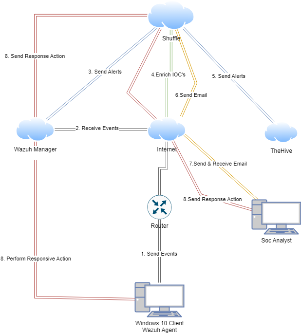
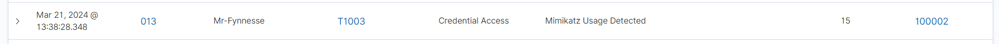
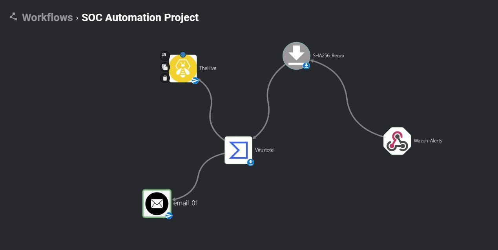
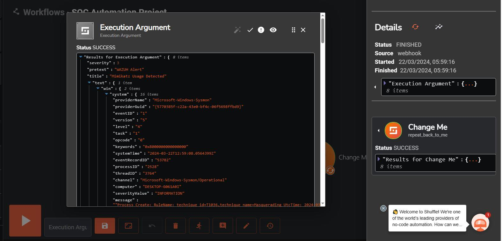
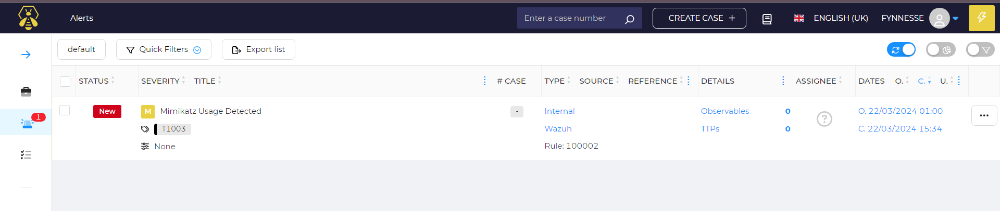

# SOC Automation Lab: Mimikatz Detection to Case Creation

**Date:** March 2024

**Environment:** Wazuh 4.7 manager and TheHive 5 on DigitalOcean (Ubuntu 22.04), Windows 10 endpoint in VirtualBox with Sysmon, Shuffle (cloud) for SOAR

**Report type:** Lab build, detection engineering and SOAR automation

---

## Summary

I built a small SOC pipeline that detects Mimikatz on a Windows endpoint and turns the detection into an enriched case without anyone touching it. A custom Wazuh rule fires on Sysmon process creation events, Shuffle pulls the SHA-256 hash out of the alert, checks it against VirusTotal, creates an alert in TheHive and emails the analyst.

The detection worked and the alert reached TheHive automatically. Two things did not come through cleanly: the hash never landed in TheHive as an observable, and a maximum-severity Wazuh alert arrived in TheHive as Medium. Both are covered in [What didn't work](#what-didnt-work).

Built by following [MyDFIR's SOC Automation series](https://www.youtube.com/@MyDFIR). The infrastructure, configuration, troubleshooting and evidence below are from my own environment.

---

## Architecture



| Step | What happens |
|---|---|
| 1 | Sysmon on the Windows 10 endpoint logs process creation. The Wazuh agent ships the events to the manager |
| 2 | Custom rule 100002 matches Mimikatz and raises a level 15 alert |
| 3 | Wazuh forwards the alert to a Shuffle webhook |
| 4 | Shuffle extracts the SHA-256 hash with a regex and queries VirusTotal for its reputation |
| 5 | Shuffle creates an alert in TheHive |
| 6 | Shuffle emails the SOC analyst |
| 7 to 8 | Designed but not evidenced here: analyst approves a response, which Shuffle sends back to the endpoint through Wazuh active response |

---

## The detection

Full rule: [`detection/mimikatz_local_rule.xml`](detection/mimikatz_local_rule.xml)

```xml
<rule id="100002" level="15">
  <if_group>sysmon_event1</if_group>
  <field name="win.eventdata.originalFileName" type="pcre2">(?i)mimikatz\.exe</field>
  <description>Mimikatz Usage Detected</description>
  <mitre>
    <id>T1003</id>
  </mitre>
</rule>
```

**Why `originalFileName` and not the image path.** Sysmon reads OriginalFileName from the PE header, not from the file on disk. Renaming `mimikatz.exe` to `notepad.exe` changes the image path but not this field, so the rule still fires.

**Why level 15.** Credential dumping is a direct path to lateral movement and domain compromise. It should sit at the top of the queue.

**Getting the events in.** Two configuration changes were needed before the rule could fire:

- The Windows agent's `ossec.conf` had to collect the Sysmon channel:
  ```xml
  <localfile>
    <location>Microsoft-Windows-Sysmon/Operational</location>
    <log_format>eventchannel</log_format>
  </localfile>
  ```
- On the manager, I enabled `logall` and `logall_json` and turned on the archives module in Filebeat, then created a `wazuh-archives-*` index pattern. This let me search every event, not just the ones that matched a rule, which is how I confirmed the Sysmon events were arriving before writing the rule.

---

## Evidence

**Rule 100002 firing on my agent**, mapped to T1003 Credential Access at level 15:



**The Shuffle workflow**: Wazuh alert webhook, SHA-256 regex, VirusTotal, TheHive and email:



**The alert arriving in Shuffle** with the full Sysmon Event ID 1 payload:



**The resulting alert in TheHive**, created automatically and tagged T1003, rule 100002:



---

## What didn't work

| Issue | What I saw | Why it matters | Fix |
|---|---|---|---|
| Hash not attached as an observable | The TheHive alert shows 0 observables and 0 TTPs | The analyst can't pivot on the hash or run analysers against it from the case. They have to dig it out of the description | Map the regex output to an `observables` entry of type `hash` in the TheHive node |
| Severity lost in transit | Wazuh rated the alert level 15. It arrived in TheHive as Medium | A credential dumping alert sits in the queue next to routine noise | Derive TheHive severity from `rule.level` instead of setting it in the node, most likely the cause here |
| Response leg not evidenced | The captured workflow stops at notification. There's no user input or Wazuh active response node | The pipeline detects and informs but doesn't contain | Add a user input step and an active response action, then test it end to end |

---

## Limitations of the rule

- **It detects a tool, not the technique.** A recompiled Mimikatz with altered PE metadata, or an in-memory variant like `Invoke-Mimikatz`, never produces a process called `mimikatz.exe`.
- **Next step:** add a rule on Sysmon Event ID 10 (ProcessAccess) where the target is `lsass.exe` with suspicious access masks. That catches credential dumping regardless of the tool used.

---

## Reproducing it

- [Windows 10 and Sysmon setup](Windows-10-and-Sysmon-Setup)
- [Wazuh install](Wazuh-install-instructions)
- [TheHive install](TheHive-Install-Instructions)
- [Full project report (PDF)](SOC-Automation-Project-Report.pdf)

**Tools:** Wazuh, Sysmon, Shuffle, TheHive, VirusTotal, DigitalOcean, VirtualBox
**Frameworks:** MITRE ATT&CK T1003 (OS Credential Dumping)
